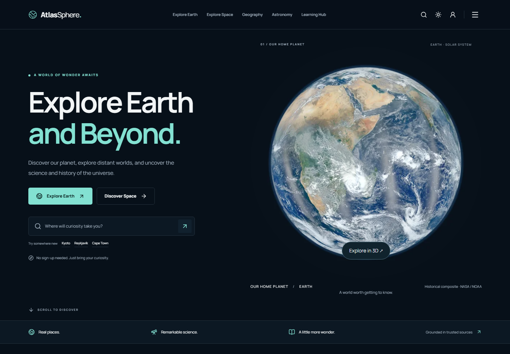

# AtlasSphere

AtlasSphere is a free educational website for exploring Earth, weather, geography and space.

[](https://github.com/panigrahi-shubham/AtlasSphere/actions/workflows/web.yml) · [Live website](https://atlassphere.vercel.app) · [API reference](https://atlassphere.vercel.app/docs/)



## What it does

- Discover Earth and space with real geographic search, an interactive globe and sourced science content.
- Explore city weather, forecasts, a country atlas, landmarks and satellite imagery.
- Explore eight planets in the interactive Solar System at `/universe/solar-system`, with an adjustable teaching clock, camera controls and sourced facts.
- Browse the planet encyclopedia at `/universe/planets`, search by name or classification, and compare up to four worlds at `/universe/compare`.
- Play GeoGuess and save personal preferences, favorites and journeys.
- Use the development-only Test Lab to practice diagnosing deliberate defects.

## Architecture

React and TypeScript power the discovery homepage; the existing Vite multi-page explorer, GeoGuess and Journeys remain available. An Express API proxies public providers and handles accounts. Prisma uses PostgreSQL; production runs on Vercel and Neon. See [architecture](docs/ARCHITECTURE.md), [account security](docs/AUTH.md) and [deployment](docs/DEPLOY_VERCEL_NEON.md).

## Test framework

The following counts describe verified local runs; some scenarios are represented in more than one suite. The production-only homepage scenarios are skipped in the development run and exercised against a production build. [Validation evidence](docs/archive/FRAMEWORK_VALIDATION.md) includes the original baseline failures and before/after counts.

| Layer | Command | Verified result |
| --- | --- | --- |
| Node unit and integration | `npm test` | 70 passed |
| Homepage and orbital-model unit | `npm run test:home:unit` | 7 passed |
| Solar System desktop and touch | `npm run test:discovery` | 10 passed, two production-only skips; 12 passed with `HOME_PRODUCTION=1` |
| API with isolated PostgreSQL | `npm run test:accounts:local` | 25 passed |
| Browser regression | `npm run test:ui` | 100 passed, one production-only skip in a normal-path checkout |
| Built explorer and geography | `npm run test:v2` | 39 passed |
| React homepage | `npm run test:home` | 20 passed, eight production-build scenarios skipped |
| Practice defects | `npm run test:bugs` | 9 passed |
| Production build | `npm run test:release` | 5 passed |
| Live provider contracts | `npm run test:api` | 13 selected; not part of the deterministic baseline |

Playwright provides isolated browser contexts, fixture-backed weather, browser traces and HTML reports. Tests using the shared UI fixture also block unexpected external requests and fail on uncaught page errors. [Test strategy](docs/TEST_STRATEGY.md) explains the suite boundaries and [known defects](docs/KNOWN_DEFECTS.md) documents the practice catalogue.

```text
tests/
  api/          live provider contracts
  api-local/    local API and PostgreSQL checks
  ui/           explorer, journeys, GeoGuess and page regressions
  home/         React homepage
  bugs/         intentional Test Lab defects
  release/      production build checks
  smoke/        persistence monitoring
  unit/         Node tests
  support/      browser fixtures and page objects
  fixtures/     deterministic provider data
```

## Quick start

Use Node.js 24 and npm:

```sh
npm ci
npm run prisma:generate
npm run dev
```

Open [localhost:5173](http://127.0.0.1:5173). Accounts and persisted journeys require a separate development PostgreSQL database; never point tests at production. See [the test quick start](tests/README.md) and [deployment guide](docs/DEPLOY_VERCEL_NEON.md).

## Known limitations

Password-reset delivery requires a configured email provider. Hosted alert checks require an external authenticated scheduler. GeoGuess scores remain in the browser. Provider budgets are per server process, not a shared serverless quota; full screen-reader and physical-device acceptance remain follow-ups. [Open-Meteo](https://open-meteo.com/) supplies weather data; NASA imagery and geographic datasets are credited in [attribution](ATTRIBUTION.md) and [photo credits](docs/PHOTO_CREDITS.md).

For compatibility, existing storage keys, cookies, headers and environment variables retain historical `SkyAtlas` or `EarthScope` names. These are application contracts and are not renamed by branding changes.
